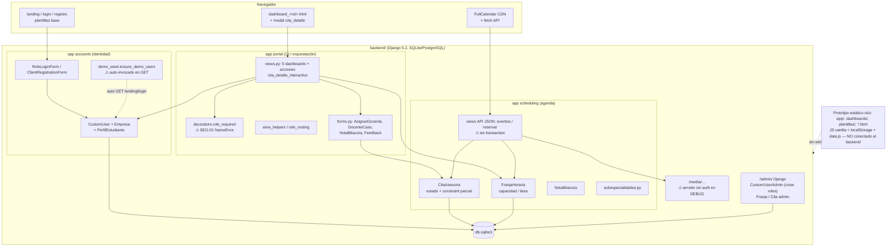

# AUDITORÍA DE ARQUITECTURA — CITI

## 1. Arquitectura real reconstruida

El proyecto es un **Django monolítico de plantillas** (sin DRF, sin SPA) con tres apps propias, más una capa de **prototipo estático** en la raíz que convive con el backend pero no forma parte de él.

- **`backend/config`** — proyecto: `settings.py` (env-driven, SQLite por defecto / PostgreSQL opcional vía `DATABASE_URL`), `urls.py` (4 mounts: `/admin/`, `/` portal, `/cuenta/` accounts, `/agenda/` scheduling) y servido de `/media/` solo en DEBUG.
- **`backend/accounts`** — identidad: `CustomUser` (email como USERNAME, `role`, `student_type`, `area`, FK `empresa`), `Empresa`, `PerfilEstudiante` con reglas de elegibilidad de tutor (`save()` promueve/degrada + señal `post_save`); `RoleLoginForm` (portal por rol); registro público solo-cliente; `demo_seed.py` auto-invocado desde `landing`/`login_view`; comando `seed_demo_users`.
- **`backend/scheduling`** — dominio de agenda: `FranjaHoraria` (capacidad por franja, área, activa), `CitaAsesoria` (máquina de estados *declarativa*, FKs docente/estudiante con `limit_choices_to`, archivo adjunto, calificación), `NotaBitacora`; catálogo de subespecialidades en Python (`subespecialidades.py`); paletas por área; **API JSON plana**: `/agenda/api/eventos/` (GET) y `/agenda/api/reservar/` (POST multipart).
- **`backend/portal`** — orquestación de UI: 5 dashboards por rol + acciones (asignar, caso docente, bitácora, feedback, acta), vista multi-rol `cita_detalle_interactivo` (partials por rol con flag `embed`), `role_required` (decorador propio con fallo crítico SEG-01), `area_helpers` (aislamiento de coordinadores), `role_routing` (mapa rol→dashboard), plantillas `templates/` y JS de modal `static/js/portal-cita-modal.js`.
- **Comunicación:** vista → form/model → plantilla; sin capa de servicios: las reglas de negocio viven en `Model.clean()` + vistas de portal; los KPIs se calculan inline en las vistas.
- **Frontend:** plantillas Django + `static/css` propios + **CDN** (FullCalendar 6.1.15, Google Fonts). No hay build ni framework JS.

### Diagrama de componentes



### Flujo de una cita (real)

```mermaid
sequenceDiagram
    participant CLI as Cliente (empresa)
    participant API as scheduling API
    participant CO as Coordinador (área)
    participant DO as Docente
    participant ES as Estudiante tutor
    CLI->>API: GET /agenda/api/eventos/ (franjas + mis citas)
    CLI->>API: POST /agenda/api/reservar/ (franja, subesp, archivo)
    Note over API: full_clean + constraint parcial; ⚠ check-then-insert sin lock
    CO->>CO: bandeja → asignar docente/tutor → ASIGNADA
    DO->>DO: en_proceso / finalizada / acta HTML
    ES->>ES: bitácoras (solo lectura/nota)
    CLI->>CLI: feedback 1–5 (una vez)
```

## 2. Modelos reales (fuente de verdad: `backend/*/models.py`)

| Modelo | Claves/relaciones | Reglas en BD verificadas |
|---|---|---|
| `CustomUser` | email PK único, `role`, `student_type`, `area`, FK→`Empresa` (SET_NULL) | único email; `full_clean()` en save() con bypass `skip_validation` |
| `PerfilEstudiante` | OneToOne→User (limit rol estudiante) | save promueve/degrada `student_type` |
| `Empresa` | razon_social, nit opcional | sin único en NIT |
| `FranjaHoraria` | inicio<fin (clean), capacidad, área, activa | índice (inicio, fin); clean no corre en bulk_create del seed |
| `CitaAsesoria` | FK franja (CASCADE), cliente (CASCADE), docente/estudiante (SET_NULL + limit_choices) | **constraint parcial único activo** (franja, cliente) verificada en SQLite; clean valida área/elegibilidad |
| `NotaBitacora` | FK cita (CASCADE), autor | — |

## 3. Duplicidad, código muerto y estructuras innecesarias

- **ARQ-17 — apps stub en la raíz** (`accounts/`, `portal/`, `scheduling/` con `models.py`/`tests.py` vacíos de `startproject`): no están en `INSTALLED_APPS` ni se importan, pero **conviven con el mismo nombre** que las apps reales → riesgo de edición errónea (AGENTS.md ya lo advierte) y confusión en el repo público.
- **Duplicación de assets:** `assets/` raíz (servido vía `STATICFILES_DIRS`) repite `citi-organigrama.png` (1.2 MB) y `citi-oficina-mockup.png` (2.5 MB) con `backend/static/images/`; además `*.html` de raíz (`presentacion.html`, `prototipo-flujos.html`, `design-system.html`, etc.) y `plantillas/`, `dashboards/`, `app/` son el espejo estático del prototipo (JS vanilla + `data.js` + `localStorage`) **sin conexión al backend**.
- **Prototipo ≠ producto:** los mockups prometen módulos que no existen en Django (talleres, prácticas, convenios, bolsa de empleo, programa radial, informes con firma, correspondencia) e implementan sesión simulada en `localStorage` (`app/js/auth.js`). Esto es la mayor inconsistencia arquitectónica: la percepción de "funcionalidad" en las capturas no corresponde al backend (F-28 en la matriz).
- **Docs vs realidad:** `docs/erd-mermaid.md` modela SOLICITUD/ASIGNACION/INFORME/FIRMA… (esquema planeado/legado) que no coincide con `CitaAsesoria`. **ARQ-16 — MEDIO**. Falta README raíz; las reglas están solo en AGENTS.md.
- **Vistas con side-effects de escritura en GET** (seed de usuarios y franjas) — mezcla de semántica HTTP y origen del problema de calendario vacío en demos (FUN-12).
- **`PerfilEstudiante.save()`** hace dos `super().save()` (uno con `update_fields`) y dispara señales que vuelven a guardar: funciona pero es frágil (riesgo de bucle/recursion silencioso; BAJO).
- **Doble sistema de permisos:** `role_required` propio + grupos/permisos Django expuestos en admin pero nunca consultados (`has_perm` no se usa) — inconsistencia conceptual (BAJO).

## 4. Separación frontend/backend y APIs

- Backend-frontend acoplado (plantillas servidor) — coherente con la escala del proyecto. El único punto "API-first" son los 2 endpoints JSON de `/agenda/`, consumidos por JS embebido del dashboard cliente.
- Las acciones del modal **son POST a vistas HTML** (no JSON) con redirecciones según flag `embed` — patrón híbrido correcto pero duplicado de la lógica de asignación/gestión con las vistas de página completa (misma lógica en 4 sitios: `coordinador_asignar`, `cita_detalle_interactivo`, `docente_caso_detalle`, partials) → **DRY roto**: cualquier regla nueva debe escribirse dos veces (BAJO/MEDIO de mantenimiento).
- Sin autenticación para API con token/session-header; usa cookies de sesión (CSRF protegido, verificado T24).

## 5. Configuración y entornos

- Sin `.env` cargado (python-dotenv instalado pero `load_dotenv` no se llama) → toda configuración depende de variables del shell — documentado en AGENTS.md y correcto.
- Dos entornos rotos: `.venv/` (Django 6.1 fuera de `requirements`) y `backend/venv/` (sin Django) conviven con el `venv/` válido — trampa para el desplegador (BAJO, documentada).
- Dependencias mínimas y sin pin de versión exacto (`requirements.txt`: `Django>=5.0,<6`, `psycopg2-binary>=2.9`, `python-dotenv>=1.0`) — reproducibilidad débil (BAJO).
- Sin contenedor, CI/CD, ni guía de despliegue.

## 6. Riesgos de evolución

- Reglas de negocio repartidas entre `Model.clean()`, forms, vistas y constraint DB sin un servicio único → difícil de testear y de mantener consistente (FUN-06 es síntoma).
- Sin logging/migración de auditoría (no existe tabla de historia de estados) → imposible demostrar trazabilidad ante jueces/auditoría real.
- Media en DEBUG y seed automático: si alguien hace `runserver --insecure` o despliega sin pensar, se activan SEG-02/03/04 todos a la vez.
