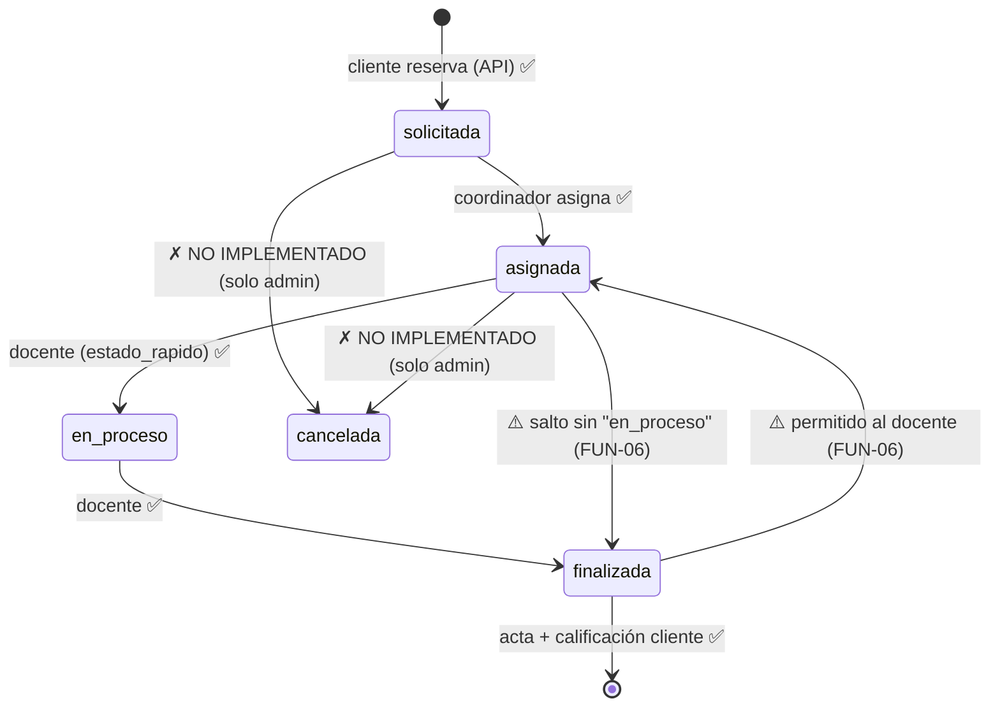

# AUDITORÍA FUNCIONAL — CITI

Verificación del comportamiento **real** (backend + navegador), no de la existencia de vistas/plantillas. Estados usados: `FUNCIONA Y FUE VERIFICADO`, `FUNCIONA PARCIALMENTE`, `NO FUNCIONA`, `NO IMPLEMENTADO`, `NO SE PUDO VERIFICAR`. Las pruebas T-xx se describen en `MATRIZ_DE_PRUEBAS.md`.

---

## 1. Matriz de funcionalidades

| # | Funcionalidad | Estado | Evidencia / observación |
|---|---|---|---|
| F-01 | Landing pública (contenidos, recursos PDF, organigrama) | FUNCIONA Y FUE VERIFICADO | GET `/` → 200 en servidor real; recursos estáticos 200 |
| F-02 | Login por portal de rol (5 roles) con selección previa de rol | FUNCIONA Y FUE VERIFICADO | T02, T03; flujo real navegador `?rol=docente` → dashboard |
| F-03 | Logout | FUNCIONA PARCIALMENTE | POST OK (sidebar); endpoint también acepta GET (SEG-21) |
| F-04 | Registro público limitado a rol Cliente/Empresa | FUNCIONA Y FUE VERIFICADO | T04; rol forzado a `cliente`, crea `Empresa` vinculada. Sin validación de contraseña (SEG-13) |
| F-05 | Recuperación de contraseña | NO IMPLEMENTADO | Sin URLs, vistas, plantillas ni backend de correo; `settings` sin `EMAIL_*` |
| F-06 | Creación de roles internos (director/coordinador/docente/estudiante) | FUNCIONA (solo Django admin) | `CustomUserAdmin` con add_fieldsets; no hay UI propia del portal — por diseño |
| F-07 | Filtro académico automático de tutores (8° semestre / 130 créditos / promedio ≥ 4.0) | FUNCIONA Y FUE VERIFICADO | T21 ascenso, T22 descenso, T20 bloqueo de tutor no-elegible vía modelo/form |
| F-08 | Calendario de disponibilidad para clientes (FullCalendar + API) | FUNCIONA PARCIALMENTE | Componente y API correctos (T-live); **hoy vacío**: todas las franjas activas están en el pasado (ver FUN-12) |
| F-09 | Reserva de cita (solicitud) vía API | FUNCIONA Y FUE VERIFICADO | T07 (200), validaciones: subesp por área T09, misma franja duplicada T08, franja agotada T07 |
| F-10 | Adjuntar documentación al reservar | FUNCIONA PARCIALMENTE | subida OK; sin validación servidor ni vista de descarga con permisos (SEG-04); en no-DEBUG la descarga no tiene cómo servirse |
| F-11 | Sobreasignación de cupos (concurrencia) | NO SE PUDO VERIFICAR (riesgo confirmado por código) | FUN-05; secuencial sí se bloquea (T07) |
| F-12 | Bandeja de asignación del coordinador (por área) | FUNCIONA Y FUE VERIFICADO | T12, T15; vista página y modal (embed) comparten lógica |
| F-13 | Aislamiento de área de coordinadores | FUNCIONA Y FUE VERIFICADO | T12 (404 en bandeja/asignar/detalle de otra área) |
| F-14 | Asignación docente + tutor con un clic | FUNCIONA PARCIALMENTE | Asigna al menos uno de los dos; **no distingue** el tipo de servicio elegido (FUN-10) y el campo de estudiante solo admite tutores (el "consultor de recepción" del caso general no es asignable) |
| F-15 | Gestión del caso por el docente (estado, resumen, bitácora) | FUNCIONA PARCIALMENTE | Funciona, pero sin máquina de estados (FUN-06): saltos, reapertura y reasignación de estudiante permitidos |
| F-16 | Cancelación de citas | NO IMPLEMENTADO (portal) | Estado existe en modelo/UI de badges; ninguna vista/URL/API lo produce; solo admin. FUN-07 |
| F-17 | Finalización y acta de cierre | FUNCIONA PARCIALMENTE | T28: exige finalizada y docente dueño; el acta es HTML imprimible (se anuncia "PDF"), sin firma ni folio real; no está accesible al cliente (solo imprime el docente) |
| F-18 | Calificación y comentario del cliente | FUNCIONA Y FUE VERIFICADO | T29 una sola calificación; T30 rango 1–5 validado |
| F-19 | Bitácora del estudiante tutor | FUNCIONA Y FUE VERIFICADO | T31 escritura propia; T32 IDOR negado |
| F-20 | Dashboard Director | FUNCIONA PARCIALMENTE | 3 KPIs reales + enlace a /admin/; sin desglose por área, tendencias, historial ni gestión propia (FUTURO). KPIs imprecisos (FUN-26) |
| F-21 | Dashboard Cliente (listado de citas, feedback) | FUNCIONA Y FUE VERIFICADO | Tabla filtrable por área en cliente; el modal de detalle funciona (HTML devuelto al destino del modal) |
| F-22 | Dashboard Docente (KPIs semana, casos) | FUNCIONA Y FUE VERIFICADO | KPIs correctos con datos reales (navegador: "1 caso asignado" consistente con BD) |
| F-23 | Dashboard Estudiante | FUNCIONA PARCIALMENTE | Lista y perfil correctos; KPI "Horas / créditos acumulados" es fórmula inventada (FUN-11) |
| F-24 | Dashboard Coordinador | FUNCIONA Y FUE VERIFICADO | KPIs por estado y bandeja correctos para su área |
| F-25 | Gestión de franjas horarias por el portal | NO IMPLEMENTADO | Solo admin Django; no hay UI para coordinador/director (FUN-28) |
| F-26 | Área "MIXTO" (Ambas áreas) | NO FUNCIONA (flujo muerto) | T10 reserva rechazada (sin subespecialidades mixtas); T34 cita mixta invisible para ambos coordinadores y no asignable |
| F-27 | API `/agenda/api/eventos/` | FUNCIONA Y FUE VERIFICADO | Solo rol cliente (por diseño actual); parámetros malformados → 400 controlado (T23) |
| F-28 | APIs y endpoints adicionales del prototipo (talleres, convenios, bolsa empleo, radial, correspondencia, informes/firmas) | NO IMPLEMENTADO | Solo existen como pantallas mock en `app/`, `dashboards/`, `plantillas/`; sin backend ni datos |

## 2. Ciclo de vida de `CitaAsesoria` — comportamiento observado

### FUN-06 — ALTO — La máquina de estados no está imposta

- **Ubicación:** `portal/views.py` (`docente_caso_detalle`, `cita_detalle_interactivo`) y `portal/forms.py` (`DocenteCasoForm`, que expone el campo `estado` con choices `asignada/en_proceso/finalizada`).
- **Evidencia:** T16 (asignada→finalizada directo, OK), **T17** (finalizada→asignada: "reapertura" sin ningún control), T18 (cancelada inalcanzable desde el form, correcto), **T20** (el docente puede cambiar `estudiante_apoyo` — decisión que pertenece al coordinador; la elegibilidad sí se filtra).
- **Impacto:** historiales imposibles de auditar (no hay bitácora de transiciones), KPIs con saltos, estados contradictorios entre la línea de tiempo y la realidad. El `timeline` del modelo asume orden estricto y mostrará fechas engañosas al reabrir.
- **Solución:** tabla de transiciones permitidas (`ASIGNADA→EN_PROCESO→FINALIZADA`) validada en el formulario/view; quitar `estado` y `estudiante_apoyo` del `DocenteCasoForm` (o dejar solo resumen_cierre + nota); log de cambios de estado.

### FUN-05 — ALTO — Concurrencia de reservas

- `reservar_cita_api` hace check-then-insert (`esta_disponible` → `save`) sin `transaction.atomic` ni `select_for_update` (grep: 0 usos en todo el backend). Dos clientes en paralelo sobre una franja de capacidad 1 pueden obtener ambos 201/200 → sobreasignación. La constraint parcial solo cubre doble-cita del **mismo** cliente en la **misma** franja (funcionó: T08). Con PostgreSQL (ruta prevista en settings) la ventana de carrera es real. **No se reprodujo bajo carga** — clasificado como riesgo alto confirmado por análisis.

## 3. Hallazgos funcionales medios

- **FUN-07 — MEDIO — Cancelación inexistente en el portal.** Ni cliente (antes de la sesión), ni coordinador, ni docente pueden cancelar; el badge `cancelada`, la línea de tiempo "cancelada" y el filtro del cupo existen, pero nada los produce. Un cliente que no asiste queda con la cita "en proceso" para siempre o depende de admin.
- **FUN-08 — MEDIO — Recuperación de contraseña.** Sin vista, sin URL, sin plantillas, sin configuración de correo. En la demo, olvidar la contraseña obliga a admin.
- **FUN-09/26 — MEDIO — Área MIXTO muerta en todo el flujo** (ver F-26). Además, `Docente.area=MIXTO` solo puede atender franjas mixtas según `CitaAsesoria.clean()` (franja `mixto` vs área del docente: `docente.area in (franja.area, MIXTO)` → docente mixto no puede atender franja sistemas). Lógica invertida respecto a la semántica esperada de "mixto".
- **FUN-10 — MEDIO — `tipo_servicio` es decorativo.** La elección del cliente ("Orientación técnica atendida por estudiante" vs "Consultoría especializada liderada por docente") no condiciona nada: asignación, dashboards y cierre son idénticos; un caso de orientación puede cerrarlo solo un docente, y un caso "especializado" puede asignarse únicamente a un estudiante, que **no tiene acciones de gestión** (solo bitácora) → un caso así nunca se finaliza desde el portal.
- **FUN-11 — MEDIO — KPI fabricado en dashboard estudiante.** `horas_acum = casos×2 + créditos//10` (`portal/views.py:276`): se presenta como "Horas / créditos acumulados" con apariencia de dato oficial; en realidad mezcla dos magnitudes y el coeficiente es arbitrario.
- **FUN-12 — MEDIO/bloqueante de demo — Datos demo desalineados + franjas en el pasado.** (a) Las 9 franjas activas están todas vencidas (última 27/10) y `_ensure_demo_franjas_horarias()` **solo** genera nuevas si no existe *ninguna* activa → calendario vacío verificado en navegador (0 eventos, semana 8–14 nov). (b) Las 4 citas del cliente real de la BD pertenecen a `carlos.ramirez@empresatolima.co`, no al cliente sembrado `cliente@empresatolima.co` → el portal de demo sembrado se ve sin historial. (c) Los estudiantes sembrados tienen perfil 0/0/0.00 → nadie es tutor elegible; la asignación de tutor en demo debe prepararse desde admin. (d) No existe cuenta demo de **Director** en el seed (solo localmente un usuario personal con is_staff). (e) Dos citas antiguas quedaron con `subespecialidad=''` (inconsistente con la regla de negocio actual). (f) Dos coordinadores civil duplicados (`coord.civil@…` y `coordinador.civil@…`).
- **FUN-13 — MEDIO — Sin acciones de agenda para coordinación/dirección.** El calendario solo es consumible por clientes; el coordinador no ve la agenda de su área (solo bandeja de solicitudes); el director tampoco. La "disponibilidad de horarios" del prompt se apoya solo en datos creados por admin o el seed.
- **FUN-28 — MEDIO — Gestión de horario sin UI:** crear/editar `FranjaHoraria` (el corazón de la agenda) exige Django admin, fuera de la narrativa del producto.
- **FUN-26 (menor) — KPIs de agregados imprecisos:** `franjas_activas` del director cuenta franjas vencidas (creada una franja en el pasado en la prueba, el KPI subió); `total_usuarios` incluye inactivos; `citas_reservadas` incluye citas de fechas pasadas no cerradas (3 de las 4 actuales están así).

## 4. Reglas de negocio verificadas ✅

- Solo clientes reservan (`CitaAsesoria.clean` + role_required) — T07/T13.
- Cupo por franja respetado en uso secuencial — T07.
- Una sola solicitud activa por cliente/franja — T08 (constraint DB confirmada presente en SQLite: `unique_cita_activa_por_cliente_franja`).
- Subespecialidad ligada al área de la franja — T09/T10.
- Docente/estudiante asignados deben coincidir con el área — T20 + revisión `CitaAsesoria.clean`.
- Tutor solo si cumple requisitos académicos — T20/T21/T22.
- Asignación exige docente o tutor — código + T15 (sin ninguno → error; no reproducido en UI, verificado por lectura).
- Feedback una sola vez y rango 1–5 — T29/T30.
- Acta solo si finalizada y para el docente dueño — T28.
- Cierre por el docente deja resumen y puede registrar bitácora — T31.
